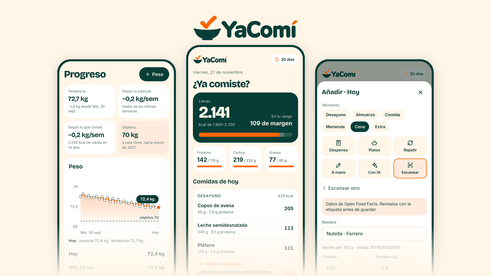
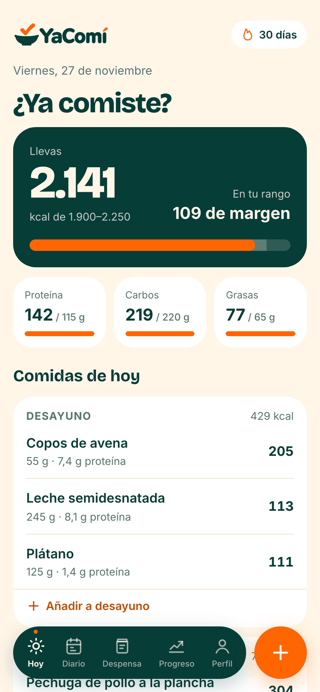
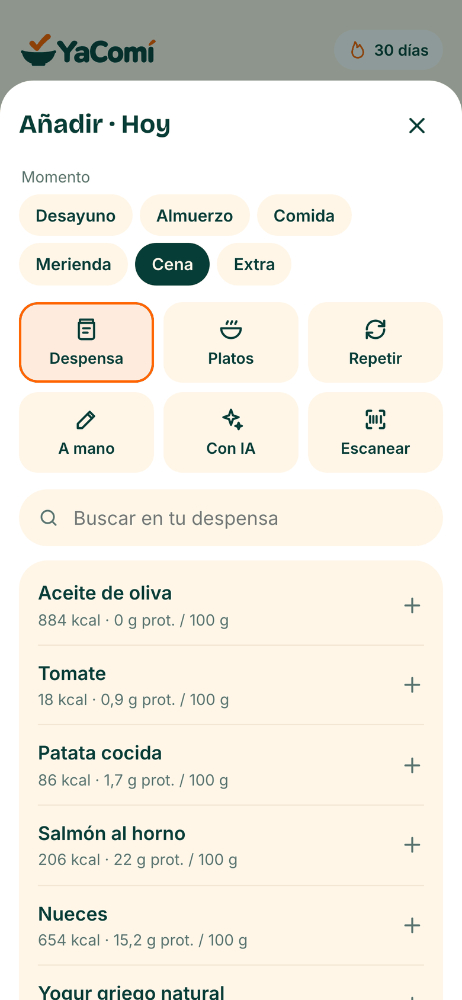
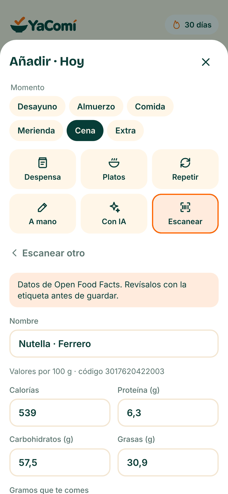
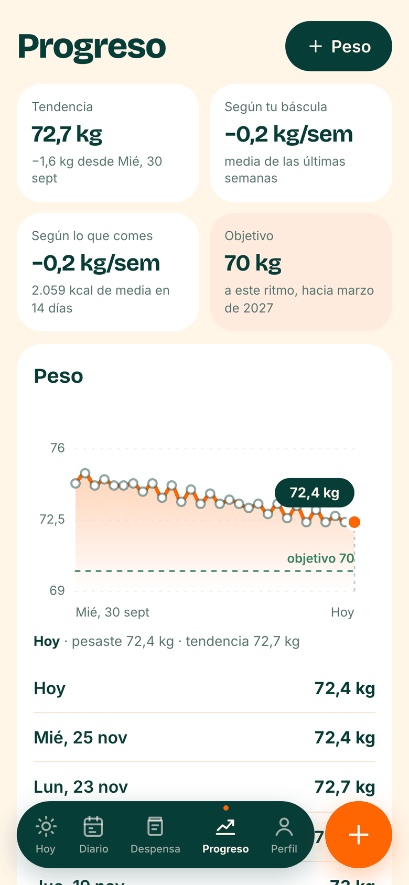
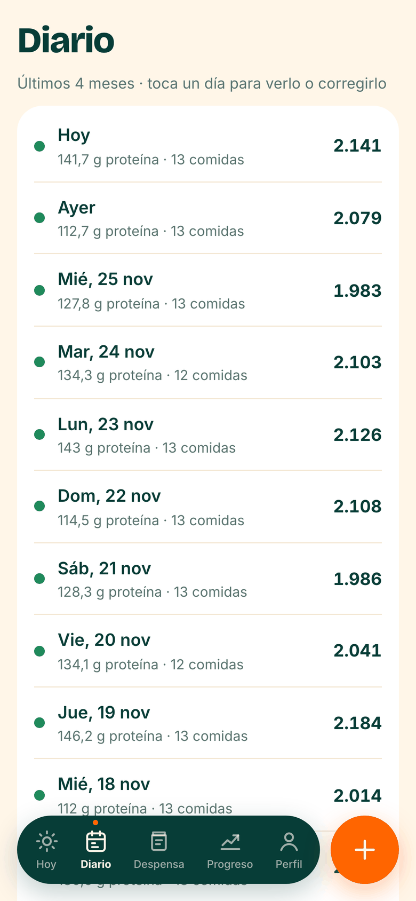
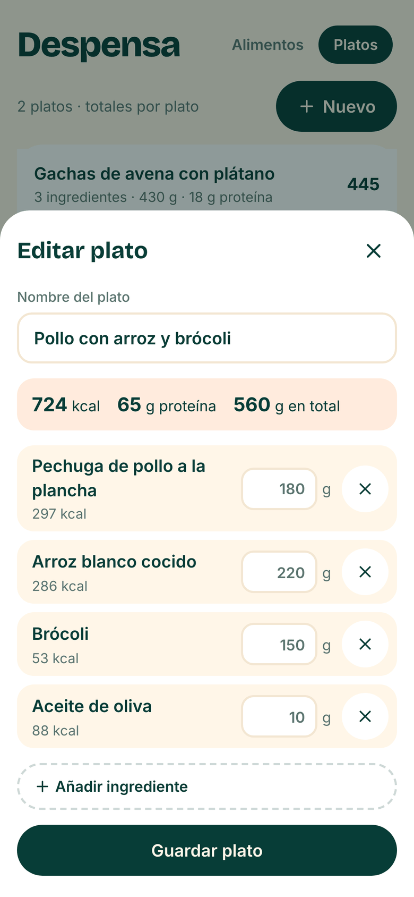
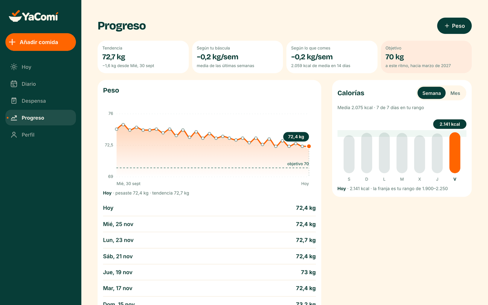

<p align="center">
  
</p>

<p align="center">
  <strong>Tu diario de comidas, sin complicaciones.</strong><br>
  Calorías, proteína y macros en unos toques. Escanea el código, describe el plato o hazle una foto, y sigue con tu día.
</p>

<p align="center">
  <a href="https://yacomi.m4rkits.dev/invitado"><strong>Pruébala ahora →</strong></a>
  &nbsp;·&nbsp;
  <a href="README.md">Read in English</a>
</p>

<p align="center">
  
  
  
  
  
</p>

---

**YaComí** es una web app pensada para el móvil con la que apuntas lo que comes. Nació como app nativa de iOS y la rehíce para la web: funciona en cualquier móvil u ordenador y lo mantiene todo sincronizado.

La demo se abre en **modo invitado**: sin registrarte, con un mes de datos de ejemplo inventados, y todo lo que cambies se queda en tu navegador.

## Lo mejor

- **Seis formas de apuntar una comida.** Desde la despensa, con un plato guardado, repitiendo algo reciente, a mano, describiéndosela a la IA o escaneando el código de barras.
- **Un escáner que conoce los supermercados finlandeses.** Busca cada producto a la vez en [Open Food Facts](https://es.openfoodfacts.org) (todo el mundo) y en S-kaupat (Finlandia), comprueba el dígito de control y necesita dos lecturas iguales antes de fiarse de un código.
- **Lee la etiqueta cuando ninguna base lo tiene.** Haz una foto a la tabla nutricional, o sube una captura de otra app, y los valores se rellenan solos. El producto se guarda con su código, así que la próxima vez sale al instante.
- **La IA calcula comida de verdad.** «Un plato de lentejas con chorizo y un poco de pan»: Gemini lo separa en alimentos con gramos y macros, y ajustas cada uno antes de guardar.
- **Un progreso en el que confiar.** Una tendencia de peso suavizada en vez del ruido de cada día, tu ritmo semanal según la báscula *y* según lo que comes, y una fecha estimada para llegar a tu objetivo.
- **Tus entrenos de Hevy** junto a tu alimentación (solo lectura).
- **Platos y recetas** con totales al momento, racha diaria, medidas corporales y un botón de deshacer para cuando se te escapa el dedo.
- **Diseñada primero para el móvil,** con menú lateral completo en el ordenador.

## Capturas

| Hoy | Añadir comida | Escáner |
|:---:|:---:|:---:|
|  |  |  |
| **Progreso** | **Diario** | **Platos** |
|  |  |  |

<p align="center">
  
</p>

> Todas las capturas usan los datos inventados del modo invitado.

## Cómo funciona

```
Navegador (React + TypeScript)
 ├── Supabase ─────────── inicio de sesión con Google y Postgres con seguridad por filas
 ├── Open Food Facts ──── búsqueda de códigos, directamente desde el navegador
 └── Worker de Cloudflare ─ sirve la app y una pequeña /api, solo con sesión iniciada
       ├── /api/ia ........ estimación de comidas con Gemini
       ├── /api/etiqueta .. lee la tabla nutricional de una foto
       ├── /api/producto .. busca el producto en S-kaupat (Finlandia)
       └── /api/hevy ...... entrenos de Hevy, solo lectura
```

- **Privada desde el diseño.** Cada tabla tiene seguridad por filas («solo lo propio») y los registros nuevos están cerrados.
- **Ninguna clave en el navegador.** Las claves de Gemini y Hevy son secretos del Worker, y cada llamada a `/api` comprueba antes la sesión de Supabase.
- **El modo invitado nunca toca el servidor.** Cambia la capa de datos por una que lo guarda todo en `localStorage`, así que un invitado no puede leer datos reales ni gastar la cuota de la IA.
- **Cada comida guarda una copia de sus valores por 100 g,** de modo que editar un alimento no reescribe tu historial, salvo que lo pidas.
- **Gratis de mantener.** Solo usa planes gratuitos: la API gratuita de Gemini, el plan gratis de Supabase y Cloudflare Workers.

## Tecnología

| | |
|---|---|
| **Interfaz** | React 19, TypeScript estricto, Vite 8 y CSS propio, sin librería de componentes |
| **Datos y acceso** | Supabase (Postgres, seguridad por filas, Google OAuth) |
| **Servidor** | Cloudflare Workers con archivos estáticos |
| **IA** | Google Gemini con respuesta JSON estructurada y modelos de reserva |
| **Códigos de barras** | `barcode-detector` con ZXing compilado a WebAssembly, servido por la propia app |
| **Integraciones** | Open Food Facts, S-kaupat, Hevy |

## Ejecutarla en local

Necesitas Node.js 20 o posterior y un proyecto de Supabase.

```bash
git clone https://github.com/M4rKitS/yacomi.git
cd yacomi
npm install
cp .env.example .env.local   # pon la URL y la clave publicable de Supabase
npm run dev
```

1. Crea la base de datos ejecutando los archivos de `supabase/migrations/`, en orden, en el editor SQL de Supabase.
2. Activa el inicio de sesión con Google en Supabase.

El modo invitado funciona sin nada de esto: abre `http://localhost:5173/invitado`.

La IA, la lectura de etiquetas, la búsqueda en S-kaupat y Hevy solo funcionan con el Worker publicado. Para publicarlo:

```bash
npm run build
npx wrangler secret put GEMINI_API_KEY   # clave gratuita de Google AI Studio
npx wrangler secret put HEVY_API_KEY     # opcional
npx wrangler deploy
```

Antes, pon tu dominio y tus datos de Supabase en `wrangler.jsonc`.

## Estructura

```
src/
  pantallas/     pantallas: Hoy, Diario, Despensa, Platos, Progreso, Perfil
  componentes/   hojas, gráficas, escáner, estimación con IA, navegación
  lib/           capa de datos (Supabase e invitado), códigos de barras, cálculo de tendencia
worker/          Worker de Cloudflare: Gemini, S-kaupat y Hevy
supabase/        migraciones SQL: esquema, permisos, vista de resumen diario
public/marca/    kit de marca: logo, iconos, imagen para redes
```

## Autor

Diseñada y programada por **Marcos** ([@M4rKitS](https://github.com/M4rKitS)), desde el primer boceto y la marca hasta el código.
