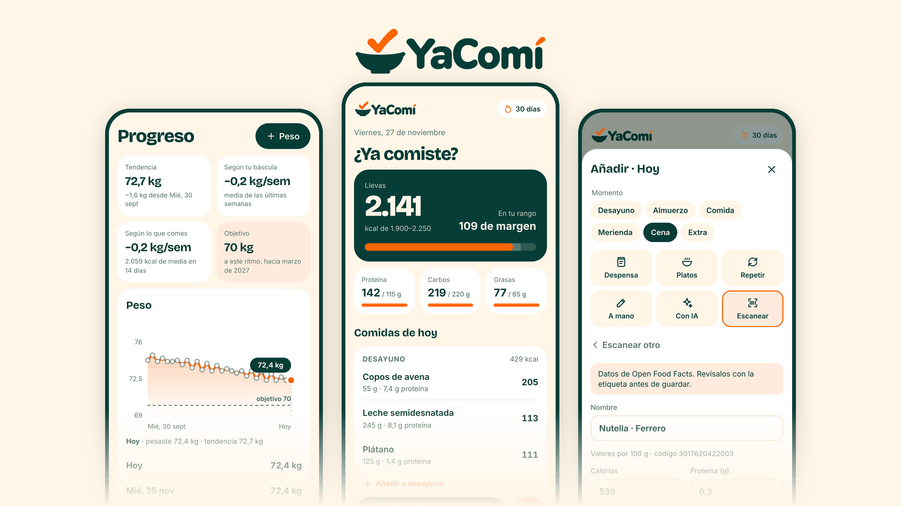
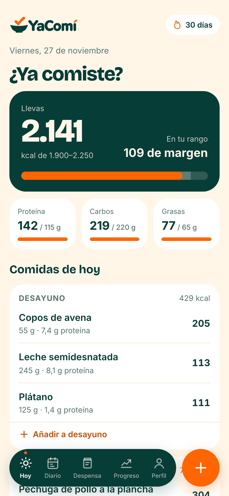
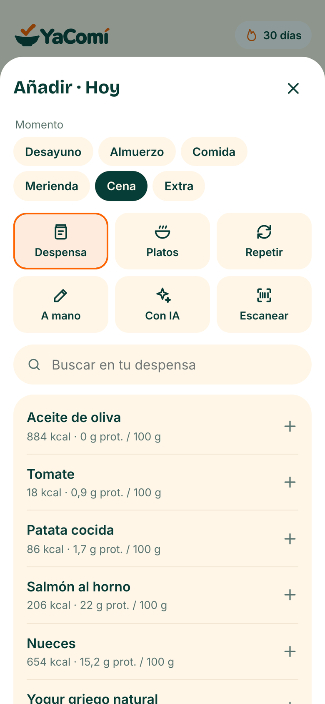
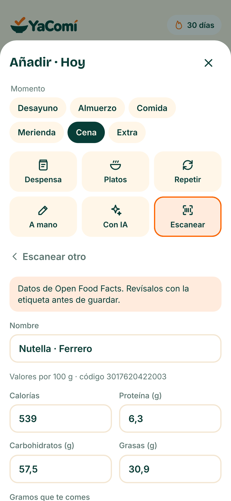
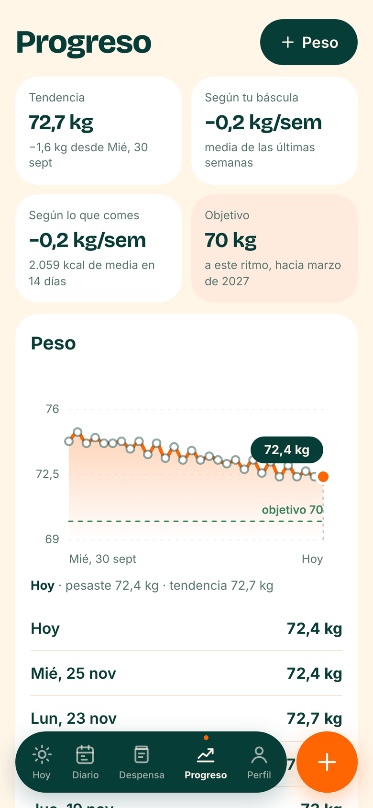
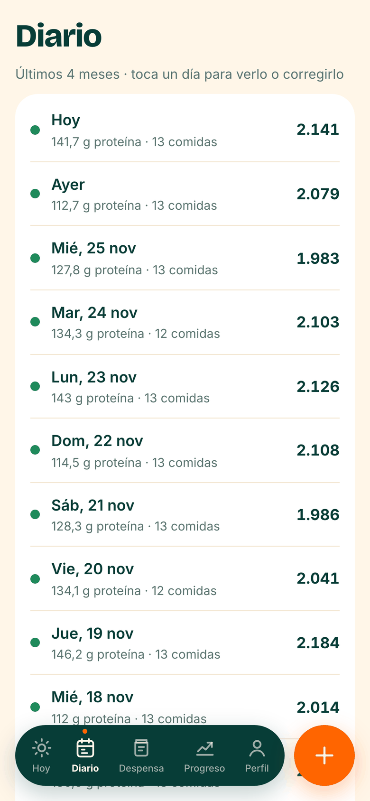
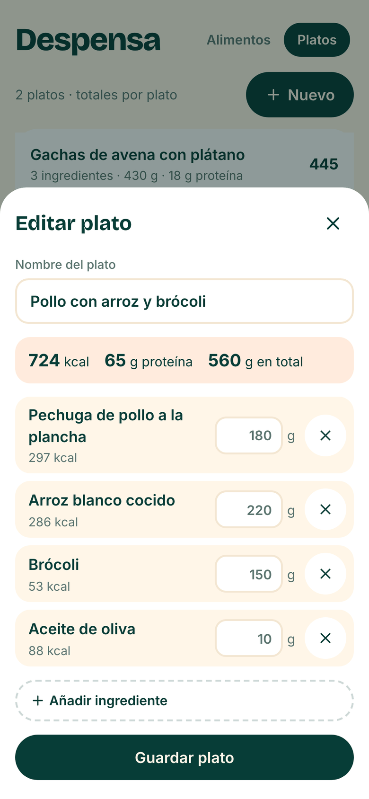
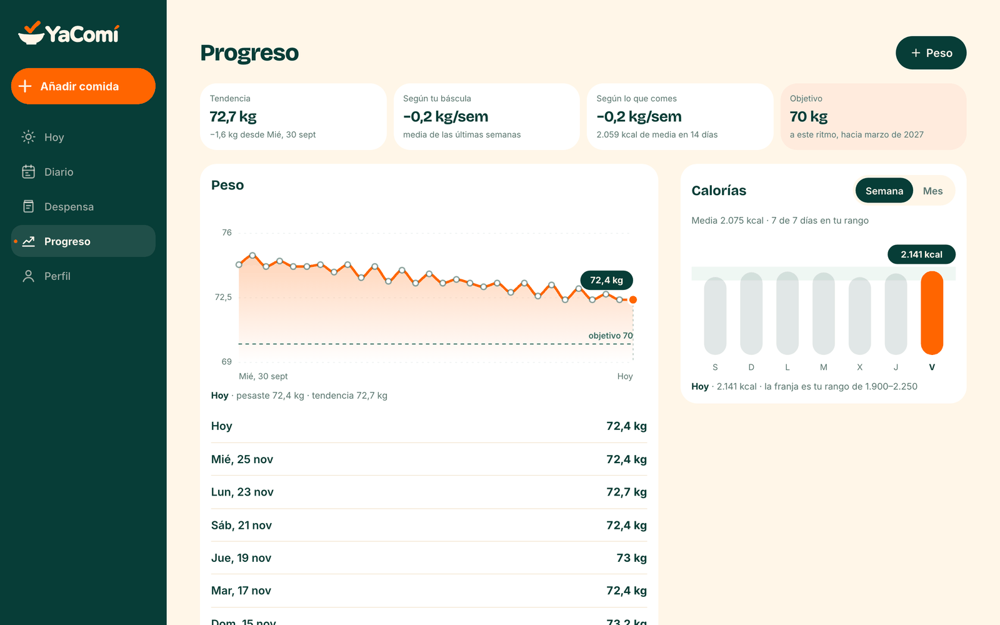

<p align="center">
  
</p>

<p align="center">
  <strong>Your food diary, without the friction.</strong><br>
  Calories, protein and macros in a few taps. Scan a barcode, describe your plate or snap a photo, and get on with your day.
</p>

<p align="center">
  <a href="https://yacomi.m4rkits.dev/invitado"><strong>Try the live demo →</strong></a>
  &nbsp;·&nbsp;
  <a href="README.es.md">Leer en español</a>
</p>

<p align="center">
  
  
  
  
  
</p>

---

**YaComí** ("I already ate", in Spanish) is a mobile-first web app for tracking what you eat. It started as a native iOS app and was rebuilt for the web, so it works on any phone or computer and keeps everything in sync.

The demo opens in **guest mode**: no sign-up, a month of made-up example data, and everything you change stays in your own browser.

## Highlights

- **Six ways to log a meal.** Pick from your pantry, add a saved dish, repeat something recent, type it by hand, describe it to the AI or scan the barcode.
- **A barcode scanner that knows Finnish shelves.** It looks up every product in [Open Food Facts](https://world.openfoodfacts.org) (worldwide) and in S-kaupat (Finland) at the same time, validates the check digit and asks for two matching reads before trusting a code.
- **Read the label when no database has it.** Take a photo of the nutrition table, or upload a screenshot from another app, and the values fill themselves in. The product is saved with its barcode, so next time it is instant.
- **AI estimates for real food.** "A plate of lentils with chorizo and some bread": Gemini splits it into foods with grams and macros, and you adjust each one before saving.
- **Progress you can trust.** A smoothed weight trend instead of daily noise, your weekly pace from the scale *and* from what you eat, and an estimated date to reach your goal.
- **Workouts from Hevy** right next to your nutrition (read-only).
- **Dishes and recipes** with live totals, a daily streak, body measurements and an undo button for when your thumb slips.
- **Designed for the phone first,** with a full sidebar layout on desktop.

## Screenshots

| Today | Add a meal | Barcode scanner |
|:---:|:---:|:---:|
|  |  |  |
| **Progress** | **Diary** | **Dishes** |
|  |  |  |

<p align="center">
  
</p>

> Every screenshot uses the made-up data from guest mode.

## How it works

```
Browser (React + TypeScript)
 ├── Supabase ─────────── Google sign-in and Postgres with row-level security
 ├── Open Food Facts ──── barcode lookup, straight from the browser
 └── Cloudflare Worker ── serves the app and a small /api, behind the user's session
       ├── /api/ia ........ meal estimate with Gemini
       ├── /api/etiqueta .. reads a nutrition label from a photo
       ├── /api/producto .. product lookup in S-kaupat (Finland)
       └── /api/hevy ...... read-only workouts from Hevy
```

- **Private by design.** Every table has row-level security ("only your own rows"), and new sign-ups are closed.
- **No keys in the browser.** The Gemini and Hevy keys live as Worker secrets, and every `/api` call checks the Supabase session first.
- **Guest mode never touches the server.** It swaps the data layer for one that stores everything in `localStorage`, so guests cannot read real data or spend the AI quota.
- **Meals keep a copy of their values per 100 g,** so editing a food never rewrites your history unless you ask it to.
- **Free to run.** It uses only free tiers: Gemini's free API, Supabase's free plan and Cloudflare Workers.

## Tech stack

| | |
|---|---|
| **Frontend** | React 19, TypeScript (strict), Vite 8, hand-written CSS with no UI library |
| **Data and auth** | Supabase (Postgres, row-level security, Google OAuth) |
| **Server** | Cloudflare Workers with static assets |
| **AI** | Google Gemini with structured JSON output, falling back across models |
| **Barcodes** | `barcode-detector` with ZXing compiled to WebAssembly, served by the app itself |
| **Integrations** | Open Food Facts, S-kaupat, Hevy |

## Run it locally

You need Node.js 20 or later and a Supabase project.

```bash
git clone https://github.com/M4rKitS/yacomi.git
cd yacomi
npm install
cp .env.example .env.local   # add your Supabase URL and publishable key
npm run dev
```

1. Create the database by running the files in `supabase/migrations/`, in order, in the Supabase SQL editor.
2. Turn on Google sign-in in Supabase.

Guest mode works without any of this: open `http://localhost:5173/invitado`.

The AI, label reading, S-kaupat lookup and Hevy only work on the deployed Worker. To deploy it:

```bash
npm run build
npx wrangler secret put GEMINI_API_KEY   # free key from Google AI Studio
npx wrangler secret put HEVY_API_KEY     # optional
npx wrangler deploy
```

Set your own domain and Supabase values in `wrangler.jsonc` first.

## Project structure

```
src/
  pantallas/     screens: Today, Diary, Pantry, Dishes, Progress, Profile
  componentes/   sheets, charts, scanner, AI estimate, navigation
  lib/           data layer (Supabase and guest), barcodes, trend maths
worker/          Cloudflare Worker: Gemini, S-kaupat and Hevy proxies
supabase/        SQL migrations: schema, permissions, daily summary view
public/marca/    brand kit: logo, icons, social image
```

## About

Designed and built by **Marcos** ([@M4rKitS](https://github.com/M4rKitS)), from the first sketch and the brand to the code. The interface is in Spanish.
